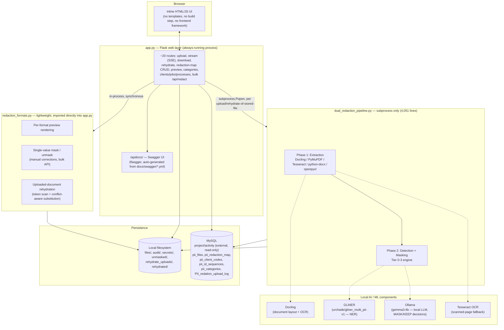
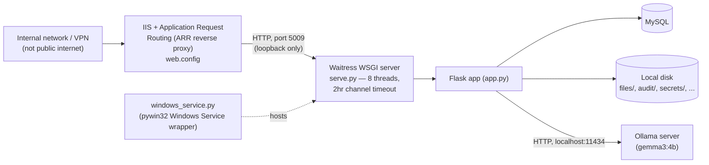

# System Architecture

*Reverse-engineered from `app.py`, `dual_redaction_pipeline.py`, `redaction_formats.py`,
`db.py`, `serve.py`, `windows_service.py`, `web.config`, and `requirements.txt`.*

## 1. Component overview



**Why the split between `app.py`, `redaction_formats.py`, and
`dual_redaction_pipeline.py` matters:** `dual_redaction_pipeline.py` eagerly loads
Docling, GLiNER, Presidio and OpenCV at import time — a multi-second, GB-scale
operation. If the Flask process imported that module directly, every web request
would carry that weight, and the always-running server would need gigabytes of RAM
just sitting idle. So:

- Heavy, ML-driven work (extraction + detection) only ever runs as an isolated
  **subprocess**, spawned per upload.
- Lightweight, format-only operations (rendering a preview, masking one value the
  reviewer typed in by hand, restoring values into an uploaded document) are
  duplicated into `redaction_formats.py` — a second, small module with only
  `openpyxl`/`python-docx`/`pymupdf`/`pillow`-class dependencies — so `app.py` can
  call them directly and get an instant response.

This is a deliberate trade-off: some logic exists twice (once heavy, once light),
in exchange for a web server that stays fast and cheap to run.

## 2. Technology stack

| Layer | Technology | Role |
|---|---|---|
| Web framework | Flask 3.1 (dev) / Waitress 3.0 (production WSGI) | HTTP server, routing, SSE streaming |
| API documentation | flasgger (Swagger/OpenAPI) | Self-documenting, testable API at `/apidocs/` |
| Database | MySQL (via `pymysql`) | Upload log, client/job lookups, redaction map, id sequences |
| Document layout/OCR | Docling (GPU: Granite-Docling 258M VLM; CPU: Layout Heron + TableFormer) | PDF → structured table extraction |
| OCR fallback | Tesseract 5.4 (`pytesseract`) | Scanned/image-only PDFs |
| PDF manipulation | PyMuPDF (`fitz`) | Native text extraction, visual redaction annotations |
| Entity recognition | GLiNER (`urchade/gliner_multi_pii-v1`) | Contextual PII detection (PERSON/ORGANIZATION/FINANCIAL/COMPANY) |
| Decision-making LLM | Ollama, running `gemma3:4b` locally | Final MASK/KEEP judgement on ambiguous candidates |
| Pattern matching | Presidio (custom AU recognizers) + hand-written regex/checksum | Deterministic ID detection (TFN/ABN/ACN/Medicare/etc.) |
| Office document handling | `python-docx`, `openpyxl`, `xlrd` | DOCX/XLSX/XLS read & write |
| Legacy `.doc` support | Word COM automation (`pywin32`) | `.doc` ↔ `.docx` conversion, `.docx` → PDF for pixel-perfect preview |
| Encryption | `cryptography` (AES-256-CBC) | Session `uid` decryption (legacy .NET-compatible scheme), encrypted-original storage for images |
| Config | `pii_rules.yaml` (hot-reloaded), `.env` | Redaction rules / allowlists; secrets and connection strings |

## 3. Deployment topology



- **Development**: `python app.py` — Flask's built-in server, single-threaded-ish,
  fine for local testing only.
- **Production**: `python serve.py` — Waitress, a pure-Python production WSGI
  server, bound to `127.0.0.1:5009` (loopback only). IIS sits in front as a reverse
  proxy (`web.config`), which is also where any external TLS termination would
  happen — **the app itself never sees HTTPS directly**.
- **Auto-start**: `windows_service.py` registers the app as a Windows Service
  (`PIIRedactionPipeline`) so it restarts automatically and survives reboots.
- **Ollama** must be running as its own separate local service
  (`http://localhost:11434`) for Tier 3 LLM decisions — the pipeline degrades
  gracefully (skips that tier) if it isn't reachable.

## 4. Threading / concurrency model

- Flask runs with `threaded=True`; Waitress runs 8 worker threads in production.
- Each upload batch spawns a `threading.Thread` that in turn spawns a
  `subprocess.Popen(dual_redaction_pipeline.py)` — the actual ML work happens in a
  separate OS process, isolated from the web server's memory space.
- The subprocess's stdout is piped line-by-line into an in-memory `queue.Queue`,
  keyed by `process_id`; `GET /stream/<process_id>` reads from that queue and
  relays it to the browser as Server-Sent Events (SSE) — this is how the live log
  console and progress bar work.
- The same background-thread + SSE-queue pattern is reused for the bulk
  `/api/redact` endpoint (`_redact_queues`, a separate dict so it can never collide
  with an upload's queue sharing the same `process_id`).
- All of this in-memory state (`_job_queues`, `_redact_queues`) lives only inside
  the single running process — it does not survive a restart, and would not be
  shared across multiple worker processes if the deployment were ever scaled
  horizontally (out of scope today; Waitress here runs as one process).

## 5. Folder layout (what's on disk and why)

```
script_pii/
├── app.py                       Flask web layer — routes, auth, orchestration
├── redaction_formats.py         Lightweight per-format mask/unmask/preview (no ML deps)
├── dual_redaction_pipeline.py   Heavy ML pipeline — subprocess only (4,051 lines)
├── db.py                        All MySQL access (upload log + redaction map + lookups)
├── crypto_utils.py              AES encrypt/decrypt (session uid + encrypted originals)
├── serve.py                     Production entrypoint (Waitress)
├── windows_service.py           Windows Service wrapper
├── pii_rules.yaml               Hot-reloaded redaction rules (allowlist, labels, regex)
├── pii_reference.md             Human-readable PII category checklist (compliance reference)
├── migrations/                  Idempotent CREATE/ALTER SQL, numbered 0001–0007
├── docs/swagger/                Per-route OpenAPI YAML fragments (used by @swag_from)
├── files/                       Uploaded inputs + output/{raw,redacted}/
├── audit/                       pii_audit_log_*.xlsx — compliance record (contains PII)
├── secrets/                     Legacy per-file secret logs + append-only forensic JSONL
├── unmasked/                    Output of the legacy file_id-based rehydrate flow
├── rehydrate_uploads/ + rehydrated/   Input/output of the derived-document rehydrate flow
├── wiki/                        Existing engineering documentation (change-log style)
└── reverse-engineering/         This document set
```
