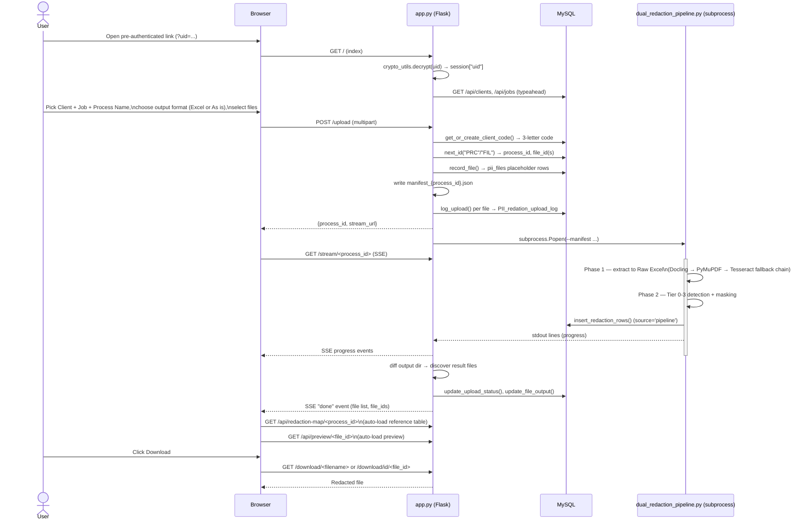
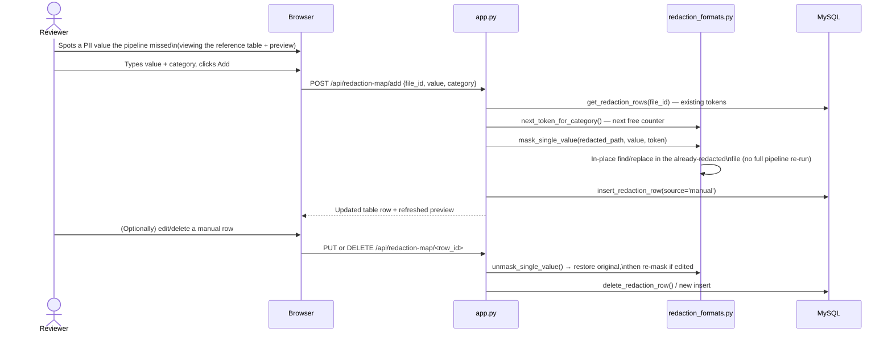
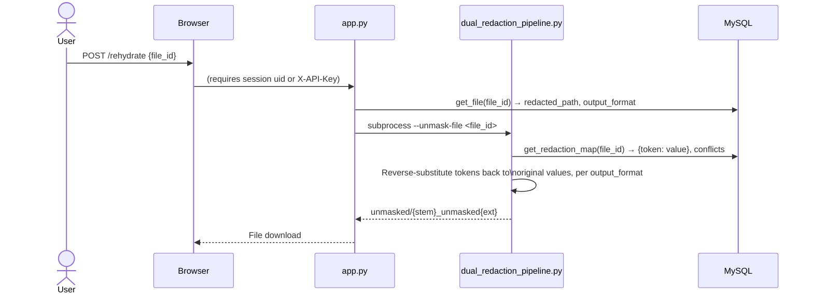
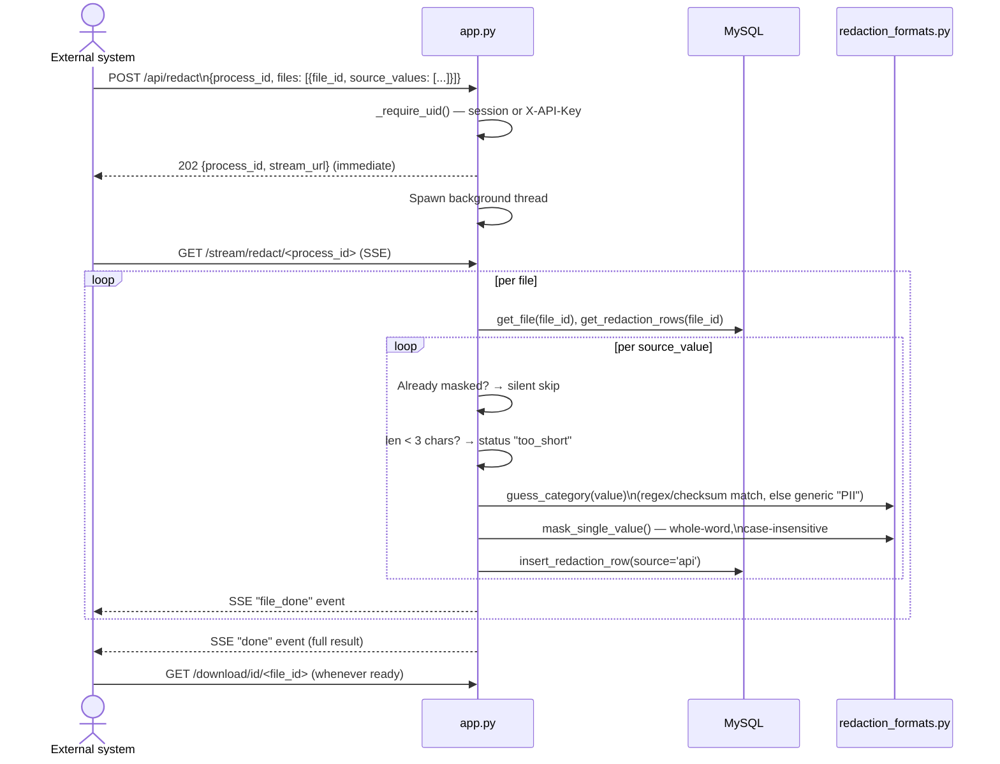
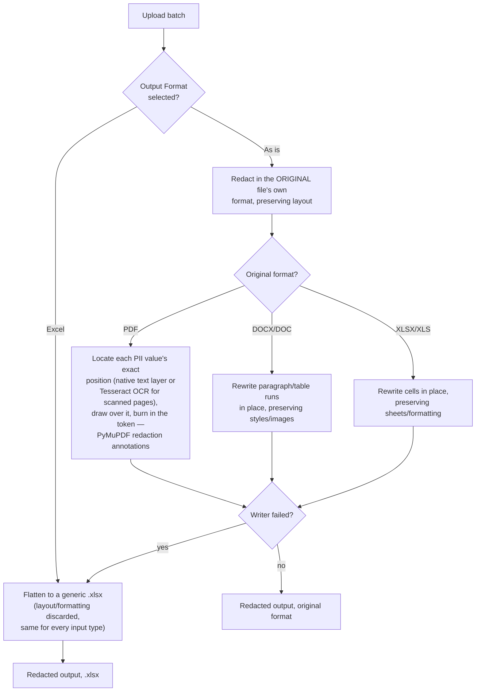

# Workflows

*Every major user-facing and system-to-system flow, reverse-engineered from
`app.py`'s route handlers and the modules they call into.*

## 1. Upload → Detect → Mask → Download (the core flow)



**Notes:**
- The `Client` and `Job` are not new concepts this app owns — they are read live
  from the firm's existing `project`/`activity` tables. Nothing is written back to
  those tables.
- The reference table and preview load automatically as soon as the run finishes —
  no extra click needed.
- If "As is" output fails for a particular file (rare, format-specific), that file
  silently falls back to the flattened Excel format, and the database is patched
  afterward to record what actually happened.

## 2. Manual correction — "Add a missed value" / edit / delete



**Key point:** this is a *targeted* patch, not a pipeline re-run. It edits the
already-redacted file directly and adds exactly one row — cheap and instant,
compared to minutes for a full Docling/GLiNER/Ollama pass. Only rows with
`source='manual'` can be edited or deleted this way; pipeline-generated rows are
read-only through this endpoint.

## 3. Rehydration — restoring the pipeline's own stored output (legacy path)



Kept in the code but no longer linked from the UI as of 2026-07-13 — superseded by
Workflow 4 below, which handles the more realistic case of a *derived* document.

## 4. Rehydration — restoring values into a derived document (current UI flow)

This is the workflow that matters in practice: several source documents get
redacted, then someone builds a **new** document elsewhere (e.g. a tax return
draft) by copying values across from those redacted outputs — including the
literal token text. That new document is what needs its original values restored.

```mermaid
sequenceDiagram
    actor User
    participant Browser
    participant App as app.py
    participant DB as MySQL
    participant Fmt as redaction_formats.py

    User->>Browser: Open /rehydrate
    Browser->>App: GET /api/clients, /api/jobs\n(pick Client + Job)
    Browser->>App: GET /api/processes?client_id=&job_id=
    App->>DB: list_processes() → named batches, newest first
    User->>Browser: Pick a Process Name
    Browser->>App: GET /api/redaction-map/<process_id>\n(files table: filename + redacted-value count only)
    User->>Browser: Upload the derived document
    Browser->>App: POST /rehydrate/upload {process_id, file}
    App->>DB: get_files_for_process(process_id)
    App->>DB: get_redaction_map_for_process(process_id)\n→ {token: {value: [file_ids]}}
    App->>Fmt: rehydrate_uploaded_file()
    Fmt->>Fmt: Scan the upload for token strings actually present
    Fmt->>Fmt: Classify: safe (1 distinct value) vs conflicting\n(2+ distinct values across the batch's files)
    Fmt->>Fmt: Substitute only the safe tokens;\nleave conflicting tokens as literal text
    Fmt-->>App: rehydrated file + list of unresolved conflicts
    App-->>Browser: File download + X-Rehydrate-Warnings header\n(if any conflicts were left unresolved)
```

**Why "conflicts" can happen at all:** token numbering restarts at 1 for every
file (`<*PERSON_1*>` in file A and file B are almost certainly different people).
Merging multiple files' token maps into one document can therefore produce a
genuine ambiguity. The system's chosen behaviour is to **never guess** — an
ambiguous token is left as visible literal text with a warning, rather than
silently substituting a possibly-wrong value.

## 5. Bulk API redaction — caller-supplied values, no automatic detection

For server-to-server callers who already know exactly which strings in a file are
PII (no ML detection needed) and just want them masked in bulk, across many files
in one call.



**This is deliberately not automated PII detection** — the caller already knows
what to redact by exact string. It reuses the same building blocks as the manual
"add a missed value" flow (Workflow 2), just looped across many files and values,
run asynchronously so a large batch doesn't block the caller's request.

## 6. Format-specific redaction: Excel vs "As is"

One dropdown, applied to the whole upload batch:



The PDF "as-is" path is a **separate, self-contained pass** over the original PDF
— it doesn't reuse the flattened Raw-Excel extraction used for the Excel output
path; it re-reads the original PDF fresh with PyMuPDF specifically to get precise
page/bounding-box coordinates for visual redaction.

## 7. Authentication decision (applies to most gated routes)

```mermaid
flowchart TD
    Req["Incoming request to a gated route"] --> HasSession{"session[\"uid\"]\nset (browser)?"}
    HasSession -- yes --> Allow["Proceed"]
    HasSession -- no --> HasKey{"X-API-Key header\npresent?"}
    HasKey -- no --> Deny403["403 Not authorized"]
    HasKey -- yes --> Valid{"hmac.compare_digest\nmatches API_KEY?"}
    Valid -- yes --> Allow
    Valid -- no --> Deny401["401 Invalid API key"]
```

See [06-security-and-auth.md](06-security-and-auth.md) for exactly which routes
this gate applies to, and which routes (e.g. `POST /upload`) have no hard gate at
all.
