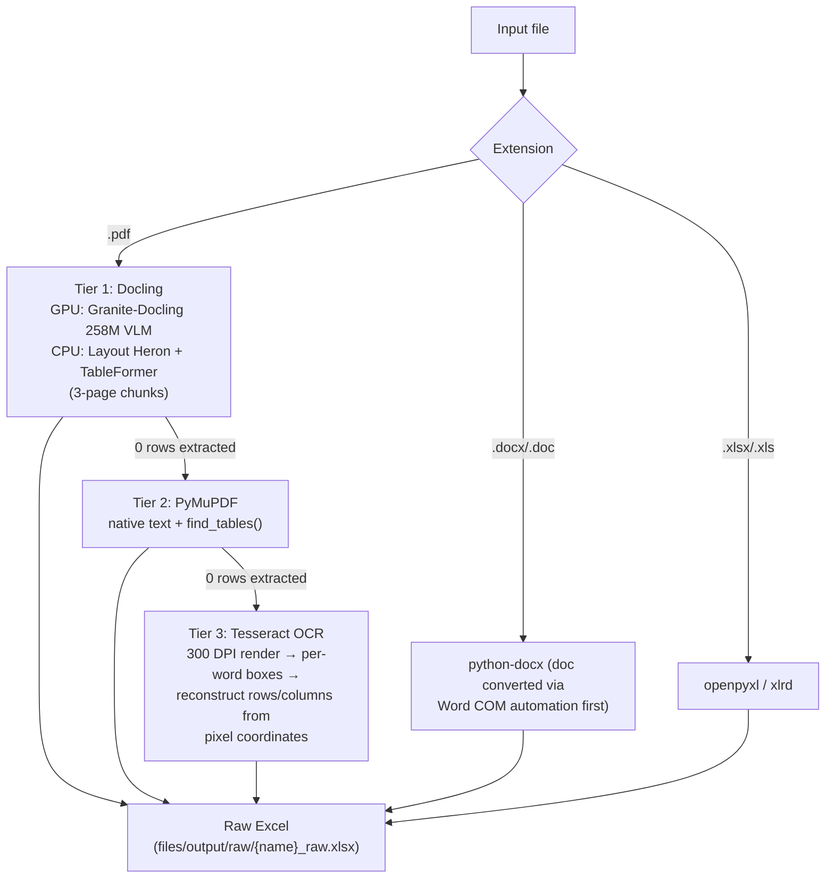
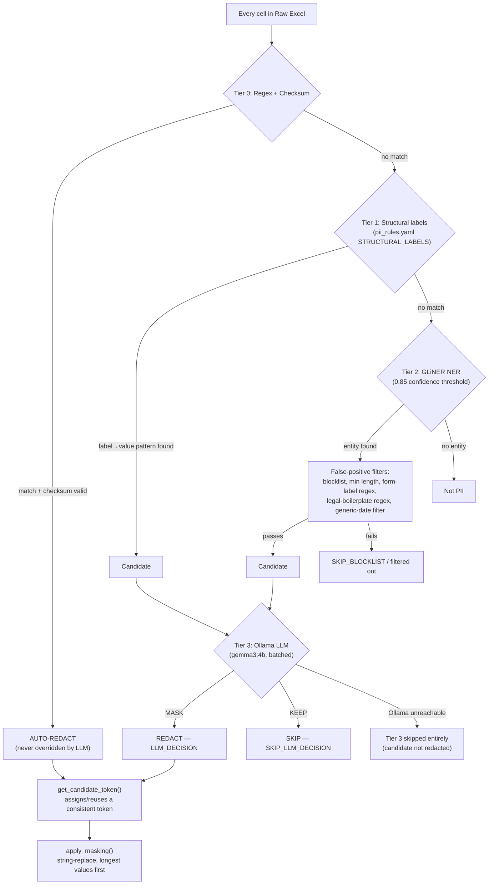

# PII Detection Pipeline — Deep Dive

*Reverse-engineered from `dual_redaction_pipeline.py`, `pii_rules.yaml`, and
`pii_reference.md`.*

The pipeline runs in two phases. Phase 1 turns a document of any supported format
into a structured, cell-by-cell representation. Phase 2 scans that representation
through four detection tiers, from cheapest/most-certain to most expensive/most
judgement-based, and replaces everything it decides to redact with a token.

## Phase 1 — Extraction (format → structured data)



Each extraction method only runs if the previous one produced **zero rows** — this
is what makes scanned/image-only tax documents (common with pre-filled ATO forms)
still work: Docling and PyMuPDF find nothing (no embedded text layer), so Tesseract
OCR takes over.

**Tesseract's row/column reconstruction** (the most manual of the three): it has no
concept of tables at all — just a flat list of words with pixel coordinates. The
pipeline groups words into lines by vertical position (±12px tolerance), then
clusters horizontal positions across all lines into column anchors (60px merge
threshold), and assigns each word to its nearest column. This preserves empty
columns that a naive left-packing approach would silently discard.

## Phase 2 — Detection and Masking



### Tier 0 — Regex + Checksum (deterministic, no judgement)

| Pattern | Validation | Token category |
|---|---|---|
| TFN (9 digits) | Weighted checksum | `GOVERNMENT_ID` |
| Medicare (10 digits + IRN) | Weighted digit checksum | `GOVERNMENT_ID` |
| ABN (11 digits) | ATO weighted checksum | `BUSINESS_ID` |
| ACN (9 digits) | ASIC weighted checksum | `BUSINESS_ID` |
| Email | RFC-style regex | `EMAIL` |
| AU phone number | +61, 02–09, 04xx, 13xx, 18xx | `PHONE` |
| BSB + account | `NNN-NNN` + 6–10 digits | `BANK_DETAILS` |

These never need AI review — the checksum mathematically confirms the pattern is a
real identifier, not just digits that happen to look like one.

### Tier 1 — Structural labels

Looks for label → value pairs on forms (`"Date of Birth: 12/03/1985"`), using a
configurable label list in `pii_rules.yaml` (`given name`, `dob`, `tfn`, `bsb`,
etc.). Also uses grid position — if the cell to the left is a known label, the
cell to the right is treated as its value even with no colon separator, which
handles tabular forms.

### Tier 2 — GLiNER (contextual NER)

A machine-learning model (`urchade/gliner_multi_pii-v1`) that recognises entities
from surrounding context, not just pattern-matching — this is what catches a
person's name or an organisation with no special formatting at all. Runs on
200-word chunks with 50-word overlap (so an entity split across a chunk boundary
isn't missed), then deduplicates overlapping detections. A confidence threshold of
0.85 filters out low-certainty guesses before they even become candidates.

**False-positive filtering after GLiNER** (before anything reaches Tier 3):
a 60+ term blocklist (ASX, ATO, state names, months, common AU abbreviations),
minimum length/alpha-content checks, a form-label regex (skips headings like
"Given Name"), a legal-boilerplate regex, and a generic-date filter (skips
financial-year references like "FY2024").

### Tier 3 — Ollama LLM decision

The final, most expensive check — only reached by candidates that survived Tiers 1
or 2's filters. A local LLM (`gemma3:4b`) is given the Australian Privacy
Principles context plus the rules from `pii_rules.yaml`, a batch of candidates
(value + surrounding context), and returns which ones to MASK. This is where
genuinely ambiguous judgement calls happen — e.g. "is this organisation name
private (redact) or a listed public company (keep)?"

**Graceful degradation:** if Ollama isn't reachable, Tier 3 is skipped entirely —
the pipeline still produces output using Tiers 0–2 only, rather than failing the
whole run. This is a deliberate design choice: availability of the AI layer never
blocks the deterministic/structural layers from doing their job.

### Token assignment and masking

Every unique value gets one consistent token for the life of that file:
`"John Smith"` → `<*PERSON_1*>` everywhere it appears. `apply_masking()` then
does the actual text substitution, replacing longest values first so a shorter
value that happens to be a substring of a longer one doesn't corrupt the
replacement.

Token numbering is **per-file** by default — the same person's name in two
different files in the same upload batch will very likely get different token
numbers, unless the newer job-scoped allocation (below) has seeded them from prior
history.

**Job-scoped token stability** (added later): rather than resetting the token
counters to zero for every single upload, the system now seeds them from every
prior `pii_redaction_map` row for the same client+job — so the same real-world
value keeps mapping to the same token across separate upload runs over time, which
is what makes cross-file rehydration (see [02-workflows.md](02-workflows.md),
Workflow 4) rarely hit a genuine conflict in practice.

## Rules configuration — `pii_rules.yaml`

Hot-reloaded (no restart needed) file controlling what gets redacted, without
touching Python code:

- **GLOBAL_RULES** — things never redacted (government bodies as organisations,
  form labels, generic financial-year dates, $0 amounts).
- **PERSON_RULES / ORGANIZATION_RULES / FINANCIAL_RULES** — category-specific
  redact/skip guidance fed into the Tier 3 LLM prompt.
- **ALLOWLIST** — ~23 hard-coded phrases always skipped (major banks, the ATO,
  super funds, generic field-label text itself).
- **STRUCTURAL_LABELS** — the label→category mapping Tier 1 uses.
- **TIER_1_REGEX** — the actual pattern definitions Tier 0 checks against.

## The audit trail — every decision, not just the redactions

Every candidate the engine evaluates — whether redacted or explicitly skipped — is
appended to `secrets/pii_forensic_log.jsonl`:

```json
{
  "timestamp": "2025-06-29T10:23:11",
  "filename": "MyDoc.pdf",
  "entity_type": "PERSON",
  "original_value": "John Smith",
  "token": "[PERSON:001]",
  "decision": "REDACT",
  "reason": "LLM_DECISION",
  "confidence": 0.91,
  "context": "Taxpayer: John Smith  DOB: 12/03/1985"
}
```

| Reason code | Meaning |
|---|---|
| `DETERMINISTIC_PATTERN` | Tier 0 regex + checksum |
| `STRUCTURAL_LABEL` | Tier 1 field-label match |
| `GLINER_SCORE` | Tier 2 NER above threshold |
| `LLM_DECISION` | Tier 3 said MASK |
| `SKIP_ALLOWLIST` | Matched an allowlist entry |
| `SKIP_LLM_DECISION` | Tier 3 said KEEP |
| `SKIP_BLOCKLIST` | Matched the NER blocklist |

This log is what makes the system's behaviour defensible after the fact: for any
value in any document, there's a record of exactly which tier saw it and why it
was or wasn't redacted — including a full account of PII the system chose to
**leave in place**, which matters just as much for a compliance review as what it
removed.

## What "PII" means here, in policy terms

`pii_reference.md` (the compliance-facing checklist this engine's rules are built
against) groups PII into eleven categories aligned to the Privacy Act 1988 and the
TFN Rule 2015: names/personal details, contact details, government identifiers
(TFN/Medicare/passport/CRN — the most sensitive tier), business identifiers,
bank/financial details, investment/super identifiers, employment information,
property/lending details, family/beneficiary information, APP-defined "sensitive
information" (health, race, religion, etc.), and financial-status information that
narrows identity when combined with other fields. It also documents what
deliberately should **not** be redacted (ATO form-item references, legal
citations, public company names alone, generic financial-year dates) — the same
distinctions Tier 3's LLM prompt and the YAML allowlist encode in the running
system.
