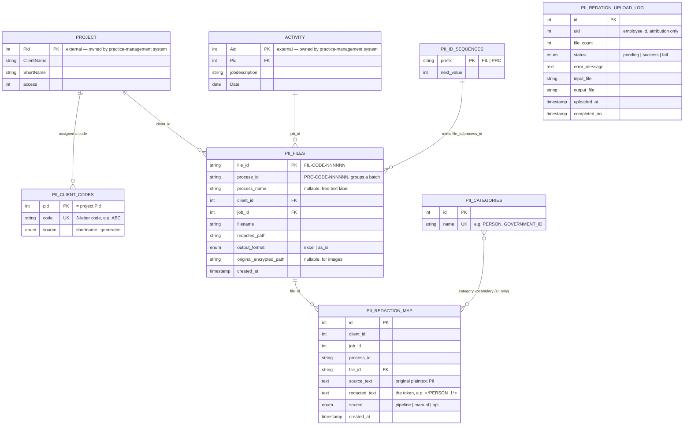

# Data Model

*Reverse-engineered from `migrations/0001`–`0007`, `db.py`, and `.env.example`.
All tables live in one MySQL database.*

## 1. Entity relationship diagram

`PII_redation_upload_log` has no foreign key to the rest of the schema — it is a
flat attribution/audit log (who uploaded what file, and whether it ultimately
succeeded), separate from the batch/file/token model above.

## 2. What each table is for

| Table | Purpose | Owned by this app? |
|---|---|---|
| `project` | The firm's existing client list | **No** — read-only |
| `activity` | The firm's existing job/work-log entries | **No** — read-only |
| `pii_client_codes` | Stable 3-letter code per client, used to build human-readable ids | Yes |
| `pii_id_sequences` | Atomic counter source for minting `FIL-`/`PRC-` ids | Yes |
| `pii_files` | One row per uploaded file: which batch, which client/job, where the redacted output lives, in what format | Yes |
| `pii_redaction_map` | One row per unique PII value redacted in a file: the real value, its token, and where it came from | Yes — the most sensitive table in the system |
| `pii_categories` | User-managed dropdown list of category names for the manual-correction UI | Yes |
| `PII_redation_upload_log` | Per-file upload attempt log (attribution + success/failure), independent of the batch/token model | Yes |

**No foreign-key constraints exist against `project`/`activity`** — this app reads
them but doesn't migrate or own them, so it can't assume it controls their
lifecycle.

## 3. Identifier scheme

- **`process_id`** (`PRC-<CODE>-NNNNNN`) — one per upload *batch*. Everything
  uploaded together (e.g. 4 documents for one client's tax return) shares one
  `process_id`.
- **`file_id`** (`FIL-<CODE>-NNNNNN`) — one per individual file within a batch.
- **`<CODE>`** — a stable 3-letter code per client (`pii_client_codes`), derived
  from `project.ShortName` if set, otherwise auto-generated from `ClientName`
  (first 3 letters, with a numeric suffix on collision). Notably, ~85% of active
  clients today have no `ShortName`, so the auto-generated fallback is the *normal*
  case, not an edge case.
- Both ids are minted **atomically** via `pii_id_sequences` (an
  `UPDATE ... SET next_value = LAST_INSERT_ID(next_value + 1)` pattern), so
  concurrent uploads never collide on the same id.

## 4. `pii_redaction_map` — the token↔value map, and why it needs careful handling

This table is where the actual plaintext PII lives once it's been extracted from a
document — for every redacted value, there's a row here containing the real
value (`source_text`) next to its token (`redacted_text`). It is the single
biggest concentration of sensitive data this application manages.

Three ways a row gets created (`source` column, extended over time):

1. **`pipeline`** — the automated Tier 0–3 detection engine found and masked it.
2. **`manual`** — a human reviewer added it via the "add missed value" flow. Only
   these rows can later be edited or deleted — pipeline rows are treated as an
   immutable record of what the automated engine actually did.
3. **`api`** — a server-to-server caller supplied the exact value via the bulk
   `/api/redact` endpoint (no automated detection involved).

**Two ways to read this table for rehydration**, and why both exist:

- `get_redaction_map(file_id=...)` — flat `{token: value}` map for one file. Used
  by the legacy single-file rehydrate path.
- `get_redaction_map_for_process(process_id)` — **conflict-preserving**
  `{token: {value: [file_ids]}}` map across every file in a batch. Because token
  numbering restarts at 1 per file, the same token string can legitimately mean two
  different real values across different files in one batch — this function
  surfaces that ambiguity instead of silently picking one (see
  [02-workflows.md](02-workflows.md) Workflow 4 for how the conflict is then
  handled: left as literal text with a warning, never guessed).

## 5. `pii_files.output_format` and why it's patched twice

The value is written once at upload time as a **placeholder** (the format the user
*requested*), then patched again after the pipeline subprocess finishes with the
format that was *actually* produced — because "As is" redaction can fail for a
specific file at runtime and silently fall back to the Excel format. The
after-the-fact patch is how `redaction_path`/`output_format` stay accurate for
rehydration to dispatch on the correct reader later.

## 6. Migration history (what changed, and why)

| Migration | Adds | Why |
|---|---|---|
| `0001` | Core tables: `pii_client_codes`, `pii_id_sequences`, `pii_files`, `pii_redaction_map` | Initial DB-backed redaction map, replacing per-file local secret logs |
| `0002` | `pii_files.output_format` | Support for format-preserving ("as is") output alongside flattened Excel |
| `0003` | `pii_files.original_encrypted_path` | Images can't be rehydrated by token search (pixel redaction is destructive) — the original is kept encrypted separately |
| `0004` | `pii_redaction_map.source` (`pipeline`/`manual`) | Distinguish automated rows (immutable) from human-added corrections (editable) |
| `0005` | `pii_files.process_name` | Free-text label per upload batch, enabling the Process Name picker on the rehydrate page |
| `0006` | `pii_categories` (new table) | Shared, user-managed category dropdown, replacing free-text category entry |
| `0007` | `pii_redaction_map.source` extended with `'api'` | Distinguish server-to-server bulk-API redactions from pipeline/manual ones |

All migrations are written idempotently (`CREATE TABLE IF NOT EXISTS`,
guarded `ALTER`s) so they're safe to re-run.

## 7. Where PII lives outside the database

The database is not the only place plaintext PII is stored — a full picture needs
the filesystem too (see [06-security-and-auth.md](06-security-and-auth.md) for the
security implications):

| Location | Contains | Sensitivity |
|---|---|---|
| `pii_redaction_map` (MySQL) | Every value redacted from a web upload, in plaintext | High — primary rehydration source |
| `secrets/pii_secret_log_*.xlsx` | Same, but only for ad-hoc CLI runs with no manifest (no client/job to attribute a DB row to) | High |
| `secrets/pii_forensic_log.jsonl` | Every value the engine *evaluated*, redacted or not, append-only | High |
| `audit/pii_audit_log_*.xlsx` | Compliance record — one row per redaction made | High |
| `files/output/raw/*_raw.xlsx` | Unredacted extraction of the source document | High — do not distribute |
| Encrypted originals (per `original_encrypted_path`) | Original image bytes, AES-encrypted | Protected at rest |
