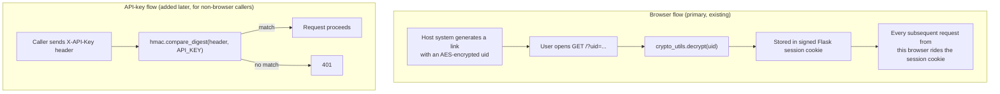

# Security and Authentication

*Reverse-engineered from `app.py`, `crypto_utils.py`, `web.config`, and the
implemented phase-1 plans (`plan-api-key-implementation.md`,
`plan-download-implementation.md`). Written to give management/security review a
factual picture — including gaps that exist today — not to make a security
recommendation on its own.*

## 1. The two authentication mechanisms

- The **browser flow** is the original and only mechanism for a long time: there
  is no login form, no password — just "did this browser session ever see a
  validly-encrypted `uid`". The encryption scheme is shared with a legacy .NET
  helper (see Section 4).
- The **API-key flow** was added specifically so non-browser, server-to-server
  callers have a way in — it's a single shared secret (`API_KEY` in `.env`),
  checked with `hmac.compare_digest` (constant-time, so response timing can't leak
  how much of the key was guessed correctly) and returns `401` (wrong credential)
  vs `403` (no credential at all) so a broken integration reads correctly.

## 2. Which routes are actually protected

`_require_uid()` gates: `/api/processes`, `/rehydrate` (POST), `/rehydrate/upload`,
`/api/redaction-map/*`, `/api/preview/*`, `/api/categories`, `/download/id/<file_id>`,
`/api/redact`. Each of these passes if **either** `session["uid"]` is set **or** a
valid `X-API-Key` is present.

**Routes with no hard gate at all, by design:**

| Route | Behaviour without any credential |
|---|---|
| `POST /upload` | Still runs, just isn't attributed to a specific employee in the upload log unless a `uid` is supplied |
| `GET /api/clients`, `GET /api/jobs` | No check at all |
| `GET /download/<filename>` | No check at all — anyone who can reach the app and guess/know a filename can download it |
| `GET /stream/<job_id>` | No check at all |
| `GET /` | No check at all (this is what decrypts `uid` into the session in the first place) |

**Net effect, stated plainly:** anyone who can reach this application over the
network can already upload and redact files, and download any file whose name
they know, with zero credential. The encrypted `?uid=` link adds *attribution* for
the browser flow (who to blame/credit for an upload), not a hard access barrier.
This was already flagged and explicitly accepted as a known trade-off in the
API-key implementation plan (`plan-api-key-implementation.md`, Open Question #6:
"internal-only network accepted as-is").

## 3. What this means for network placement

The application binds to `127.0.0.1` in production; IIS (`web.config`) reverse-
proxies to it. **The application itself never terminates TLS** — whatever HTTPS
protection exists is entirely a property of the IIS binding in front of it, which
is outside this codebase. Today's accepted operating assumption (per the same
plan) is that this app sits on an internal/VPN-only network, not the open
internet — the authentication model above was explicitly built against that
assumption, not as a standalone perimeter.

## 4. The encryption scheme, and a specific finding worth flagging

`crypto_utils.py` derives its AES key via PBKDF2-HMAC-SHA1 from a **hardcoded
password (`"MAKV2SPBNI99212"`) and salt (`"Ivan Medvedev"`)**. This exact
password/salt pair is a widely-known, publicly-documented example from an old
ASP.NET `Rfc2898DeriveBytes` tutorial that has been copy-pasted into countless
unrelated codebases over the years — it is **not a secret specific to this
application**, and treating it as one would be a mistake. Its presence here
appears to be for interoperability with an existing legacy .NET system that
already uses this exact scheme to generate the `?uid=` link (matching it exactly
is *why* it's hardcoded this way, not an oversight) — but it does mean:

- Anyone who recognises this well-known key/salt pair (a quick web search
  surfaces it) can construct their own valid encrypted `uid` value without ever
  seeing this codebase, and open the app "authenticated" as any `uid` they choose.
- This is the same key used for `encrypt_bytes()`/`decrypt_bytes()` (encrypted
  original images) — though those use a random IV per call, the underlying key
  material is the same publicly-known value.

This is worth a deliberate, documented decision (accept the risk because the
network is trusted/internal, or migrate the link-generation scheme to a private
key) rather than being carried forward as an unexamined legacy detail.

## 5. Authorization gap (distinct from authentication)

`_require_uid()` only proves *someone* is authenticated (browser session or valid
API key) — it does **not** check that the specific `uid`/API caller is entitled to
see the specific `client_id`/`job_id`/`process_id`/`file_id` being requested. This
gap was explicitly identified and left open during the rehydration-feature design
(`plan-rehyrdration-implementation.md`, Open Question #8) and again in the API-key
plan (Section 8, Out of Scope): **any authenticated caller today can rehydrate,
preview, or download any client's data**, not just their own. This is a
deliberate, currently-accepted scope limitation, not an oversight introduced by a
single feature — worth surfacing explicitly to a security/compliance reviewer.

## 6. Where plaintext PII actually lives (attack surface for data-at-rest)

See [04-data-model.md](04-data-model.md) Section 7 for the full list. In summary,
plaintext original PII values exist in: `pii_redaction_map` (MySQL, the primary
store), `secrets/pii_secret_log_*.xlsx` (legacy CLI-only runs), `secrets/pii_forensic_log.jsonl`
(append-only, every value ever evaluated), `audit/pii_audit_log_*.xlsx`, and
`files/output/raw/*.xlsx` (the unredacted extraction). None of these locations
currently have field-level encryption at rest — they rely on filesystem/database
access control, which is outside this codebase's own enforcement.

## 7. Input handling

- Upload size capped at 200 MB per file (`MAX_CONTENT_LENGTH`), enforced both in
  Flask and mirrored in IIS's `requestFiltering` limit — these two must be kept in
  sync manually if either changes.
- Extension allowlist (`.pdf .xlsx .xls .docx .doc .png .jpg .jpeg`) rejects
  anything else at upload time.
- `secure_filename()` (Werkzeug) is applied to uploaded filenames before they
  touch the filesystem, mitigating path-traversal via a crafted filename.
- No rate limiting or brute-force protection exists on the API-key check itself —
  accepted as sufficient today given the key's entropy (a `secrets.token_hex(32)`-
  class random value) and the internal-network assumption (Section 3), per the
  API-key plan's own Out-of-Scope notes.

## 8. Summary for a security review

| Question a reviewer would ask | Answer, as implemented today |
|---|---|
| Is there a login system? | No — pre-authenticated encrypted link (browser) or shared API key (server-to-server) |
| Is every sensitive route gated? | No — several routes (`/upload`, `/download/<filename>`, client/job lookups) have no gate at all, by explicit design decision |
| Is access scoped per client? | No — any authenticated caller can see any client's data (Section 5) |
| Is the encryption key for the `uid` link secret? | No — it's a well-known, publicly-documented example value (Section 4) |
| Is transport encrypted? | Only if IIS's binding in front of the app is HTTPS — the app itself is plain HTTP internally |
| Is there an audit trail? | Yes — extensively, both for redaction decisions (forensic log) and uploads (upload log) |
| Is PII stored in plaintext anywhere? | Yes, in multiple places (Section 6), required for the system's reversible-by-design rehydration feature to work at all |
