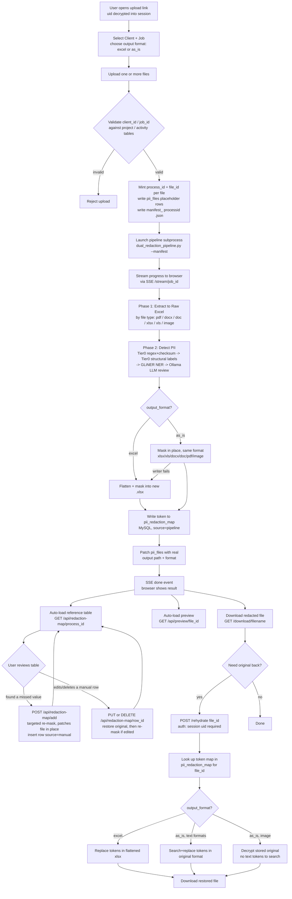
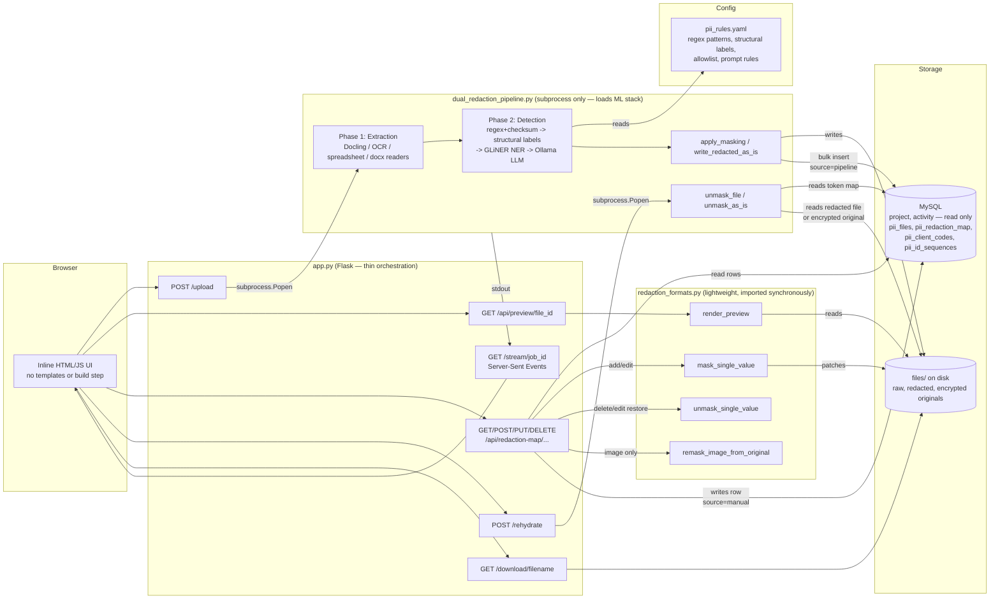
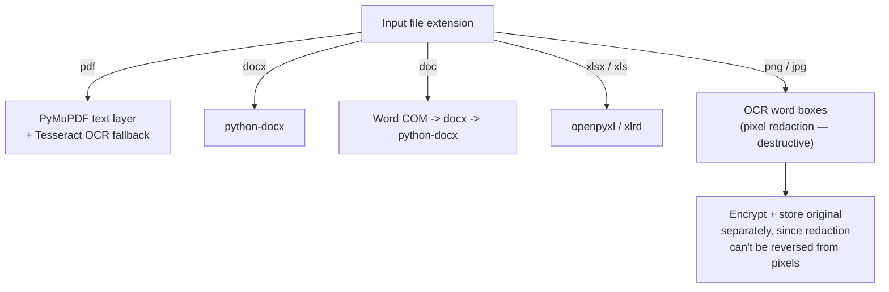

# Process & Approach Flow Diagrams

Two diagrams, both reflecting the current codebase (including the untracked
`redaction_formats.py`, the `as_is` output path, image handling, and the
manual "reference table" correction flow):

1. **Process Flow** — what happens, step by step, from a user's point of view (upload → detect → mask → review/correct → rehydrate).
2. **Approach Flow** — the technical/architectural view: which module does what and how data moves between them.

> Rendering note: these are Mermaid diagrams. GitHub, Azure DevOps, and the
> VS Code "Markdown Preview Mermaid Support" extension render them inline.

---

## 1. Process Flow Diagram

End-to-end journey of a file, from upload to (optional) rehydration.

**Notes on the process:**
- Detection is tiered and short-circuits: Tier 0 (regex + checksum: TFN/ABN/ACN/Medicare/email/phone/BSB) auto-redacts deterministically; only ambiguous PERSON/ORGANIZATION/DATE/FINANCIAL candidates reach the local Ollama LLM.
- `as_is` mode preserves the original file's look, but silently falls back to the flattened Excel output per-file if the format-specific writer fails — the *actual* format used is only known after the pipeline runs, so `app.py` patches the DB afterward.
- Images are a special case: pixel redaction is destructive, so the original is encrypted and stored separately rather than relying on token search for rehydration.
- The manual "add missing value" correction is a **targeted patch**, not a full pipeline re-run — it edits the already-redacted file in place and adds one `source='manual'` row, which is the only kind of row that can later be edited/deleted.

---

## 2. Approach / Architecture Flow Diagram

How the modules are structured and why (technical approach), including
the data flow between them.

**Why it's split this way:**

| Concern | Module | Reason |
|---|---|---|
| Web routes, upload handling, SSE, DB orchestration | `app.py` | Needs to respond fast; must **not** import the ML stack |
| Extraction + tiered detection + full mask/unmask | `dual_redaction_pipeline.py` | Loads Docling, GLiNER, Presidio, cv2 at import — multi-second, GB-scale, so it only runs as an isolated subprocess |
| Single-value mask/unmask, preview rendering | `redaction_formats.py` | A deliberately duplicated, lightweight subset of the same per-format logic, so the reference-table UI (add/edit/delete/preview) can call it synchronously from `app.py` without paying the ML-import cost |
| Detection rules | `pii_rules.yaml` | Hot-reloaded config (regex patterns, structural labels, allowlist, LLM prompt fragments) — no code change needed to tune redaction |
| Redaction map / audit trail | MySQL `pii_redaction_map` | `source ENUM('pipeline','manual')` (migration 0004) keeps pipeline output immutable while allowing manual corrections to be edited/deleted |

**Format dispatch (branches inside both `dual_redaction_pipeline.py` and its
lightweight counterpart):**

---

## Planned, not yet built

`wiki/feature-updates/phase-1/plan-rehyrdration-implementation.md` describes a
proposed extension: rehydrating a **downstream/derived** document (e.g. a tax
filing built off the redacted output elsewhere) against one `file_id`'s token
map, in-process via `redaction_formats.py` rather than the current
subprocess route. This is still design-stage — a few open questions in that
doc are unresolved — so it's intentionally left out of the diagrams above.
